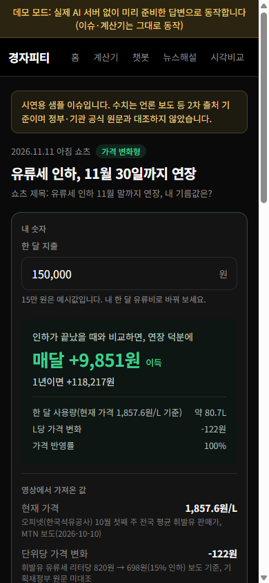
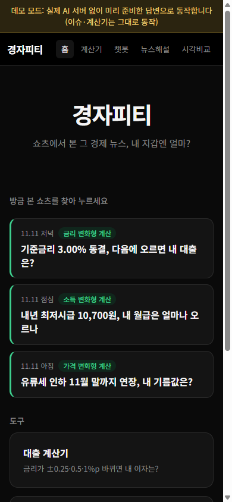
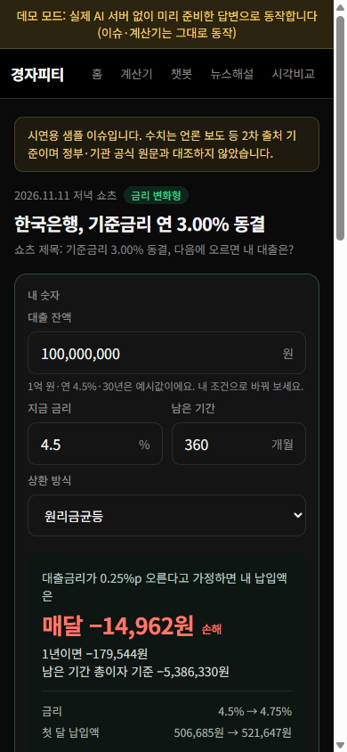
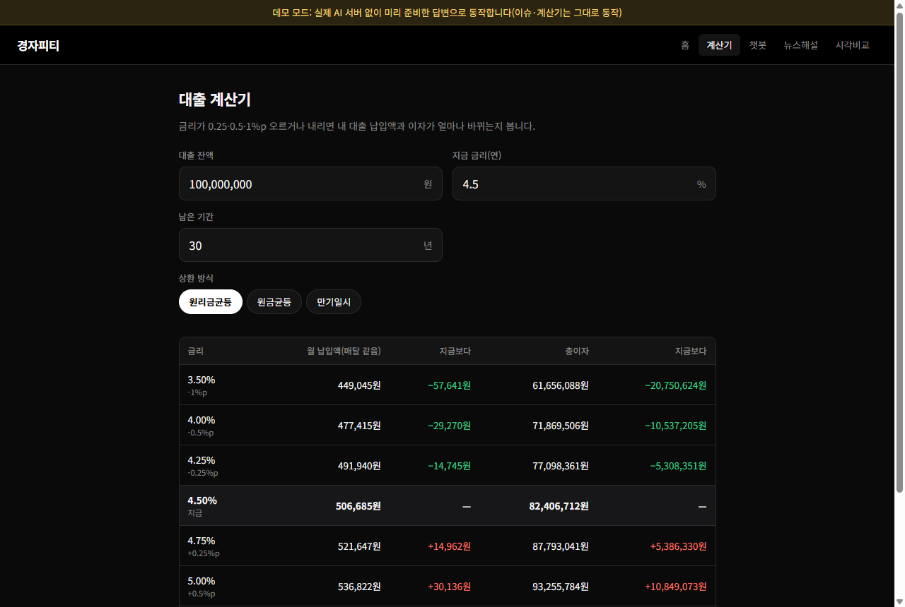
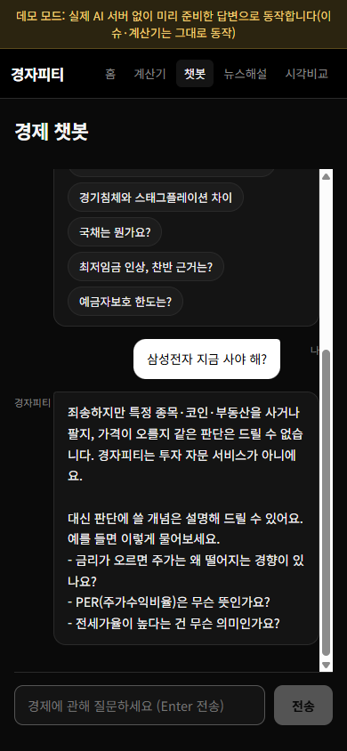

# 경자피티 — 내 지갑 기준 경제 해설

쇼츠에서 본 경제 뉴스가 **내 지갑에 얼마나 영향을 주는지** 숫자로 보여 주는 웹 서비스입니다. 이름은 "경제적 자유 피티"의 줄임말입니다. 유류세·최저임금·기준금리 같은 이슈마다 영상에 나온 값이 계산기에 미리 들어가 있어서, 내 숫자 하나만 넣으면 이득인지 손해인지 바로 보입니다.

> 아직 배포하지 않았습니다. 아래 "개발자용 정보"의 방법으로 내 PC에서 실행할 수 있습니다.

## 이게 뭔가요

뉴스 쇼츠를 보다 보면 "그래서 나한테는 얼마인데?"가 궁금해집니다. 경자피티는 그 질문에 답하는 계산 창구입니다. 주유소 영수증을 들고 "유류세 인하가 끝나면 나는 한 달에 얼마 더 내지?"라고 물으면 계산기를 두드려 주는 친구를 생각하시면 됩니다.

쇼츠 한 편마다 이슈 페이지가 하나씩 생깁니다. 이슈 페이지를 열면 맨 위에 계산기가 있고, 그 아래에 30초 요약, 내 상황별 영향(대출자·세입자·예금자·직장인·자영업자), 왜 이런 일이 생겼는지, 다르게 보는 시각, 출처가 이어집니다. 계산은 전부 프로그램 코드가 합니다. AI에게 숫자 계산을 맡기지 않습니다.

## 이런 분께 필요해요

- 쇼츠에서 "유류세 인하 연장", "기준금리 동결" 같은 소식을 봤는데, 내 기름값이나 대출 이자가 실제로 얼마나 바뀌는지 알고 싶을 때
- 내 대출 금리가 0.25%p, 0.5%p, 1%p 오르거나 내리면 매달 내는 돈과 총이자가 어떻게 바뀌는지 표로 보고 싶을 때
- 최저임금·부동산 규제처럼 의견이 갈리는 주제를 한쪽 결론 없이 나란히 보고 싶을 때

## 화면으로 보기



유류세 인하 연장 이슈 페이지를 휴대폰 화면으로 연 모습입니다. 한 달 유류비 15만 원(예시값)이 들어가 있고, 그 아래에 "연장 덕분에 매달 +9,851원 이득"이 바로 보입니다. 15만 원을 내 유류비로 바꾸면 결과가 곧바로 다시 계산됩니다. 계산에 쓴 영상 속 값(리터당 1,857.6원, 리터당 −122원)은 그 아래에 출처와 함께 적혀 있습니다.



홈 화면입니다. 맨 위에 쇼츠 제목 그대로 이슈가 최신순으로 나옵니다. 쇼츠를 보고 프로필 링크로 들어온 사람이 방금 본 영상을 찾아 바로 누를 수 있게 하려는 구성입니다.



기준금리 이슈 페이지입니다. 내 대출 잔액·금리·남은 기간·상환 방식을 넣으면 "금리가 0.25%p 오른다고 가정하면 매달 −14,962원 손해"처럼 결과가 나옵니다.



대출 계산기입니다. 원리금균등·원금균등·만기일시 세 가지 상환 방식에 대해, 금리가 ±0.25·0.5·1%p 바뀔 때 월 납입액과 총이자를 표로 보여 줍니다.



경제 챗봇에 "삼성전자 지금 사야 해?"라고 물었을 때의 화면입니다. 종목을 사고팔지는 답하지 않고, 판단에 쓸 개념 질문을 대신 안내합니다.

## 할 수 있는 것

서비스는 두 가지 방식으로 실행됩니다. 실서비스 방식은 챗봇·뉴스 해설 같은 일부 기능에서 실제 AI(Google의 Gemini)를 부릅니다. 호출할 때마다 사용량이 쌓여 무료 한도를 넘으면 사용료가 발생할 수 있습니다. 데모 방식은 AI를 부르지 않고 미리 작성한 답변만 보여 주므로 비용이 들지 않습니다. **이슈 페이지와 계산기는 처음부터 AI를 쓰지 않아서 두 방식 모두에서 똑같이 동작합니다.**

| 기능 | 하는 일 | 실서비스 | 데모 |
| --- | --- | --- | --- |
| 이슈 페이지 | 쇼츠 1편마다 계산기 + 요약 + 상황별 영향 + 시각 + 출처. 영상 속 값이 계산기에 미리 들어가 있음 | 동작 | 동작 (샘플 3개) |
| 내 상황 기억 | 대출자·세입자 등을 고르면 내 영향이 맨 앞에 나오고, 이 기기에서 다음에도 기억 | 동작 | 동작 |
| 내 지갑 장부 (`/wallet`) | 올라온 이슈를 내 지갑 숫자로만 계산해 달별로 쌓고 매달 합계를 보여 줌. 가정 계산 이슈는 합계에서 빼고, 내 숫자가 없는 이슈는 무엇을 넣으면 되는지 안내 | 동작 | 동작 |
| 내 지갑 (`/me`) | 대출·월급·한 달 지출 등을 한 번 넣어 두면 모든 이슈 계산기와 대출 계산기에 내 숫자가 자동으로 들어감. 이슈 계산기에서 "이 숫자를 내 지갑에 저장"도 가능. 이 기기 브라우저에만 저장(서버 전송 없음) | 동작 | 동작 |
| 경제적 자유 숫자 (`/freedom`) | 한 달 생활비·모아 둔 돈·한 달 저축으로 목표 금액(1년 생활비 ÷ 인출률)과 도달 시점을 계산. 저축 +10만 원, 생활비 −10만 원, 수익률 가정 ±1%p, 이번 달 장부 영향을 반영했을 때 몇 년 당겨지는지 비교. 수익률(기본 실질 2%)·인출률(기본 4%)은 가정으로 표시하고 사용자가 바꿈 | 동작 | 동작 |
| 대출 계산기 | 원리금균등·원금균등·만기일시, 금리 ±0.25·0.5·1%p 표 | 동작 | 동작 |
| 시각 비교 | 최저임금 인상·부동산 규제·재정 확대·기본소득의 대표 시각을 같은 형식으로 나란히 | 4개 주제 + 다른 주제는 AI | 4개 주제만 |
| 경제 챗봇 | 용어·현상 질문에 ① 한 줄 요약 ② 쉬운 설명 ③ 내 지갑 영향 ④ 출처 순서로 답함. 앞 대화를 이어서 이해 | 자유 질문 (AI) | 예시 질문 8개만 |
| 뉴스 해설 | 기사를 붙여 넣으면 무슨 일인가 / 왜 / 누구에게 어떤 영향 / 다른 시각 순서로 정리 | 동작 (AI) | 동작 안 함 |
| 투자 권유 거절 | 종목·코인·부동산 매수·매도, 목표가, 가격 예측 질문은 AI에 보내기 전에 거절 | 동작 | 동작 |
| 홈 화면에 추가 | 휴대폰이나 PC에 앱처럼 설치 | 가능 | 가능 |

실서비스 방식의 AI 기능(챗봇·뉴스 해설·다른 주제 비교)은 코드로 구현돼 있지만, **사용료 문제로 실제 AI를 불러 답변 품질을 확인하지는 않았습니다.** 자동 테스트에서는 AI 응답을 가짜로 바꿔 서버 동작만 확인했습니다.

데모에서 챗봇이 답할 수 있는 질문은 다음 8개입니다. 질문을 똑같이 쓰지 않아도 "주담대", "환율"처럼 핵심 단어가 들어 있으면 해당 답을 찾습니다.

1. 기준금리가 오르면 내 대출은?
2. 인플레이션이 뭔가요?
3. 환율 오르면 뭐가 비싸지나요?
4. 전세와 월세 중 금리 영향을 더 받는 건?
5. 경기침체와 스태그플레이션 차이
6. 국채는 뭔가요?
7. 최저임금 인상, 찬반 근거는?
8. 예금자보호 한도는?

## 어떻게 동작하나요

**쇼츠에서 경자피티로 들어오기까지**

1. 쇼츠가 경제 이슈를 다룹니다.
2. 같은 조사 자료로 이슈 페이지 데이터(JSON 파일)를 만듭니다. 처음에는 "초안" 상태라 화면에 나오지 않습니다.
3. 사람이 숫자·출처·말투를 확인하고 "게시"로 바꿉니다. 확인할 항목은 [docs/issue-format.md](docs/issue-format.md)에 있습니다.
4. 시청자가 채널 프로필 링크로 들어와 홈에서 방금 본 쇼츠 제목을 누릅니다.

유튜브 쇼츠는 2023년 8월부터 설명란·댓글의 링크를 누를 수 없게 바뀌었습니다. 그래서 쇼츠마다 링크를 거는 대신, 프로필 링크 하나로 들어와 홈에서 고르는 구조로 만들었습니다. 인스타그램 스토리 링크 스티커처럼 누를 수 있는 곳에서는 이슈 페이지 주소(`/i/이슈아이디`)를 바로 걸 수 있습니다.

**계산은 어떻게 하나요**

이슈마다 계산식을 새로 짜지 않습니다. "가격 변화형(유류세·전기요금)", "금리 변화형", "소득 변화형(최저임금)", "환율형", "지원금형" 다섯 가지 계산 틀을 코드로 미리 만들어 두었습니다. 이슈 데이터는 이 중 어떤 틀을 쓸지와 영상에 나온 숫자만 고릅니다. 숫자마다 출처를 적지 않으면 형식 검사에서 떨어지도록 했습니다.

예를 들어 유류세 이슈는 "한 달 유류비 ÷ 리터당 가격 = 한 달 주유량, 주유량 × 리터당 인하액 = 아끼는 돈"으로 계산합니다. 인하분이 주유소 가격에 다 반영되지 않을 수도 있어서, "반영되는 비율"을 바꿔 볼 수 있게 했습니다.

**AI를 쓰는 곳에서 지키게 한 원칙**

챗봇·뉴스 해설은 질문 앞에 다음 원칙을 붙여 AI에게 보냅니다(`backend/prompts.js`).

- 한국어로, 중학생도 이해할 수준으로. 전문용어는 처음 나올 때 괄호로 풀이
- 종목·코인·부동산 매수/매도 추천, 목표가, 수익률 예측은 거절하고 판단에 쓸 개념만 설명
- 수치에는 기준 시점을 붙이고, 최신 수치를 확실히 모르면 지어내지 말고 "한국은행 ECOS에서 확인 필요"로 표시
- 견해가 갈리는 주제는 한쪽 결론을 내지 않고, 특정 정당·정치인을 평가하지 않음
- 출처가 불확실하면 "출처 확인 필요"로 표시

AI에 보내기 전에 서버가 먼저 투자 권유성 질문을 거릅니다. 예를 들어 "삼성전자 지금 사야 해?", "반도체주 들어가도 돼?", "목표가 알려줘"는 AI를 부르지 않고 바로 거절 안내를 돌려줍니다. "매수가 뭐예요?", "금리가 오르면 주가는 왜 떨어지나요?" 같은 개념 질문은 통과시킵니다. 다만 이 필터는 단어 목록으로 거르는 방식이라 모든 표현을 잡지는 못합니다.

## 데모 답변·샘플 이슈의 수치는 확인했나요

정직하게 적습니다. "검색으로 확인"은 이번 작업 중 웹 검색 결과(주로 언론 보도)와 대조했다는 뜻이고, 정부·기관 원문 문서를 직접 열어 대조했다는 뜻은 아닙니다.

| 내용 | 쓴 곳 | 확인 정도 |
| --- | --- | --- |
| 예금자보호 한도 1억 원(2025년 9월 1일 시행), 상호금융 포함, 보호 안 되는 상품 | 챗봇 8번 | 금융위·예보 보도자료 내용을 검색으로 확인. PDF 원문은 직접 열지 않음 |
| 2027년 최저임금 10,700원, 2026년 10,320원, 3.7% 인상 | 챗봇 7번, 최저임금 이슈 | 언론 보도로 확인. 최저임금위원회 고시 원문은 대조 안 함 |
| 월 209시간 기준 월급 2,236,300원, 인상분 79,420원 | 챗봇 7번, 최저임금 이슈 | 코드로 계산(테스트로 검증) |
| 기준금리 연 3.00% 동결(2026년 10월 22일) | 기준금리 이슈 | 언론 보도·KDI 자료 요약으로 확인. 한국은행 결정문 원문은 대조 안 함 |
| 유류세 인하 11월 30일까지 연장, 휘발유 리터당 약 122원 인하 | 유류세 이슈 | 2차 출처(정리 글·보도)로 확인. **출처끼리 날짜가 서로 다른 기사도 있었음.** 기획재정부 원문은 대조 안 함 |
| 휘발유 전국 평균 1,857.6원(10월 첫째 주) | 유류세 이슈 | 언론 보도(오피넷 인용)로 확인. 오피넷에서 직접 조회는 안 함 |
| 1억 원·30년·4.5%→4.75% 월 납입 약 1만 5천 원 증가 | 챗봇 1번, 기준금리 이슈 | 코드로 계산(테스트로 검증) |
| 전월세 전환율 상한 = 기준금리 + 2%p와 연 10% 중 낮은 쪽 | 챗봇 4번 | 작성자 지식 기준. 법령 원문 대조 안 함 |
| 개인투자용 국채 2024년 6월 도입 | 챗봇 6번 | 작성자 지식 기준. 대조 안 함 |
| 환율 1,300원 → 1,400원 | 챗봇 3번 | 설명용 예시 숫자(실제 환율 아님) |
| 한국은행 경제용어사전 항목명 | 챗봇 전체 출처 | 해당 항목이 사전에 실제로 있는지는 확인 안 함 |
| 시각 비교 4개 주제의 근거 | 시각 비교 | 일반적으로 거론되는 논거를 정리. 개별 연구·자료와 문장 단위로 대조 안 함 |

샘플 이슈 3개는 화면 맨 위에 "시연용 샘플, 공식 원문과 대조하지 않음" 안내가 붙어 있습니다.

## 아직 부족한 점

- 실제 사용자는 아직 없습니다. 만든 사람이 테스트한 것이 전부입니다.
- 실서비스 방식의 AI 답변은 사용료 문제로 실제로 불러 본 적이 없습니다. 답변이 ①~④ 순서를 지키는지, 수치를 지어내지 않는지, 중립을 지키는지 확인하지 못했습니다.
- 쇼츠 자동 제작 과정과는 아직 연결하지 않았습니다. 이슈 데이터 형식과 승인 체크리스트만 정해 두었고([docs/issue-format.md](docs/issue-format.md)), 지금 있는 이슈는 손으로 만든 샘플 3개입니다.
- 승인은 JSON 파일의 `status`를 직접 바꾸는 방식입니다. 휴대폰으로 누르는 승인 화면은 없습니다.
- 투자 권유 필터는 단어 목록 방식이라 우회 표현을 다 잡지 못합니다. 실서비스에서는 AI 쪽 원칙이 두 번째 방어선입니다.
- 계산은 단순화한 모델입니다. 대출 계산기는 중도상환수수료·우대금리·보증료를 넣지 않았고, 이슈 계산기는 "다른 조건이 같다면"을 가정합니다.
- 계산 틀 중 환율형·지원금형은 테스트는 했지만 샘플 이슈가 없어 화면에서 써 보지는 않았습니다.
- 어떤 쇼츠가 사람을 데려오는지 볼 방문 집계 기능이 없습니다.

## 개발자용 정보

### 기술 스택

| 구분 | 기술 |
| --- | --- |
| Frontend | React · Vite · React Router · PWA (`vite-plugin-pwa`) |
| Backend | Node.js · Express |
| AI | Google **Gemini API** (REST, 외부 SDK 없이 Node `fetch`, 모델 `gemini-3.5-flash`) — 챗봇·뉴스 해설·자유 주제 비교에만 |

형제 프로젝트 [politics-ai](https://github.com/yeomhojun1/politics-ai)(정CHPT)와 같은 구조입니다. `backend/validate.js`·`rateLimit.js`·`errors.js`는 그대로 가져왔습니다.

### 구조

```
gyeongja-pt/
├─ shared/investFilter.js      # 투자 권유 1차 필터 (서버·데모 공용)
├─ backend/                    # Express API 서버 (Gemini 호출), prompts.js = 답변 원칙
├─ frontend/
│  ├─ src/lib/loan.js          # 대출 상환 공식 3종
│  ├─ src/lib/templates.js     # 이슈 계산 틀 5종
│  ├─ src/lib/issues.js        # 이슈 데이터 형식 검사·정렬
│  ├─ src/content/issues/      # 이슈 페이지 데이터(JSON) ← 쇼츠 제작 과정이 여기에 초안을 만든다
│  ├─ src/content/compare.js   # 시각 비교 4개 주제
│  └─ src/demo/                # 데모 빌드 전용 가짜 API·예시 답변
└─ docs/issue-format.md        # 이슈 데이터 형식·승인 체크리스트
```

### 실행 방법

```bash
# 테스트 (루트에서, API 키 불필요, Gemini 호출은 가짜로 대체, Node 20 이상)
npm test                 # 백엔드 27개 + 프론트 57개

# 1) 백엔드 (기본 포트 4005)
cd backend
npm install
cp .env.example .env     # .env 에 GEMINI_API_KEY 설정
npm start

# 2) 프론트엔드 (다른 터미널에서)
cd frontend
npm install
npm run dev
```

### 환경변수

**backend/.env** (`backend/.env.example` 복사)

```
PORT=4005
GEMINI_API_KEY=your-gemini-api-key
# ALLOWED_ORIGINS=http://localhost:5174   # 미설정 시 5173/5174/4173 허용
# RATE_LIMIT_PER_MIN=10                   # AI 호출 경로 IP당 분당 허용 횟수, 0 이면 제한 없음
```

**frontend/.env** (`frontend/.env.example` 복사)

```
VITE_API_URL=http://localhost:4005
```

> `GEMINI_API_KEY` 를 설정하기 전까지 AI 기능 3종(챗봇·뉴스 해설·자유 주제 비교)은 503 과 한국어 안내를 반환합니다. 이슈 페이지·계산기·시각 비교 4개 주제·투자 권유 거절은 키 없이도 동작합니다.

> 경자피티의 계산과 해설은 참고용이며 투자·금융 상품 권유가 아닙니다.

### 데모 빌드 (GitHub Pages)

`VITE_DEMO=true` 로 빌드하면 백엔드·AI 없이 브라우저 안의 가짜 API(`frontend/src/demo/`)로 동작합니다. 라우터는 HashRouter, 경로는 `/gyeongja-pt/` 로 바뀝니다. 평소 빌드에는 데모 답변이 들어가지 않습니다.

```bash
cd frontend
npm run build:demo
npx vite preview --mode demo     # http://localhost:4173/gyeongja-pt/
```

`main` 에 push 하면 `.github/workflows/pages.yml` 이 데모를 빌드해 GitHub Pages 에 배포합니다.
